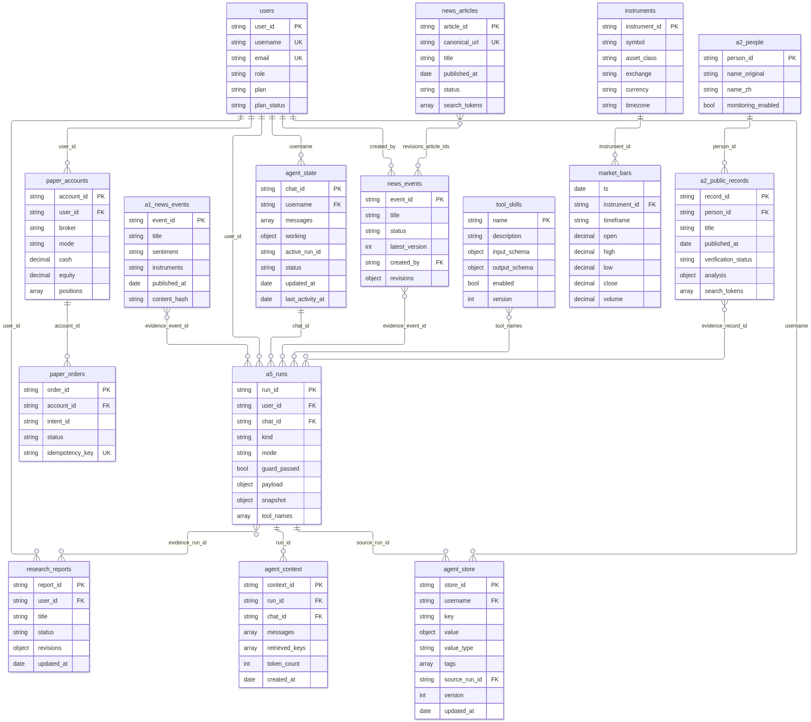

# PrismQuant MongoDB 資料庫殼

PrismQuant 專案的獨立 MongoDB 資料庫殼。

這個 repo 只包含**資料庫結構**：

- 16 個 Collection
- JSON Schema 驗證器
- 索引
- 一個 time-series Collection（`market_bars`）
- 少量虛構示範資料
- 結構測試（smoke test）

它**不會**連到 A1／A2／A3／A4／A5、網站或任何現有應用的儲存層，也不會取代現有應用的資料庫；這不是 production 部署。

## 需求

- MongoDB 8.0（本機安裝或 Docker）
- Python 3.10+
- `pymongo`

## 快速開始（Docker）

```bash
docker compose up -d
python -m pip install -r requirements.txt
python init_db.py
python seed_demo.py
python smoke_test.py
```

預期最後一行：

```text
PASS  16 collections, document validators, indexes, time-series, uniqueness
```

開啟 MongoDB Compass，連線到：

```text
mongodb://127.0.0.1:27017
```

資料庫：`prismquant`

## 快速開始（本機 MongoDB）

如果 MongoDB 已經在 `127.0.0.1:27017` 執行：

```bash
python -m pip install -r requirements.txt
python init_db.py
python seed_demo.py
python smoke_test.py
```

使用其他 server 或資料庫：

```bash
python init_db.py --uri mongodb://127.0.0.1:27017 --db prismquant
python seed_demo.py --uri mongodb://127.0.0.1:27017 --db prismquant
python smoke_test.py --uri mongodb://127.0.0.1:27017 --db prismquant
```

也支援 `MONGO_URI` 與 `MONGO_DB` 環境變數；請參考 `.env.example`。

## 指令

| 指令 | 用途 |
|---|---|
| `python init_db.py` | 建立缺少的 Collection、驗證器與索引；可重複執行 |
| `python init_db.py --reset` | 先刪除目標資料庫；具破壞性 |
| `python seed_demo.py` | 寫入虛構示範資料 |
| `python smoke_test.py` | 檢查 Collection、驗證器、索引、time-series 與唯一性 |

不要在重要資料庫上執行 `--reset`。

## Collection 一覽

| Collection | 用途 |
|---|---|
| `users` | 使用者帳戶、角色、方案與配額 |
| `instruments` | 跨市場工具主檔 |
| `market_bars` | OHLCV time-series，以 `instrument_id` 識別工具 |
| `a1_news_events` | A1 產生的結構化新聞事件 |
| `news_articles` | 新聞全文與分析 |
| `news_events` | 多來源、帶版本的新聞事件 |
| `a2_people` | 受監控人物 |
| `a2_public_records` | 公開發言與分析 |
| `a5_runs` | 決策紀錄、replay 快照與證據 |
| `agent_context` | 單次 LLM 調用的工作記憶 |
| `agent_state` | 單一 chat window 的狀態 |
| `agent_store` | 跨會話長期記憶，`(username, key)` 唯一 |
| `tool_skills` | A5 工具註冊表 |
| `paper_accounts` | 模擬交易帳戶 |
| `paper_orders` | 模擬訂單與冪等鍵 |
| `research_reports` | 版本化研究報告 |

## 關係圖



Mermaid 原始碼在 `docs/relationships.mmd`。

## 記憶模型

三個記憶 Collection 刻意分開：

| Collection | 範圍 | 生命週期 |
|---|---|---|
| `agent_context` | 單次 LLM 調用 | 不設 TTL；調用完成後可由執行環境清理 |
| `agent_state` | 單一 chat window | 不設 TTL；聊天刪除或歸檔時移除 |
| `agent_store` | 跨會話 | 不設 TTL；使用者刪除 key 或帳戶關閉時移除 |

`agent_store` 使用唯一複合索引：

```text
(username, key)
```

每個 key 對應一份 JSON `value`；它是長期偏好與需求的目錄，不是對話的副本。

## 設計說明

- `market_bars` 的 time-series `metaField` 使用 `instrument_id`，不是 `symbol`，避免不同交易所同一代號碰撞。
- `a5_runs` 保存決策當下的輸出 payload 與輸入快照；新聞全文與 K 線留在各自的 Collection。
- `agent_state` 與 `agent_store` 刻意**不設 TTL 索引**。
- JSON Schema 驗證器覆蓋 15 個 document Collection。MongoDB 8.0 不支援 time-series Collection 的 validator，所以 `market_bars` 由 ingestion／application layer 驗證。
- Collection 之間沒有資料庫層外鍵；參照完整性由應用層處理。
- 這個殼預設使用 standalone MongoDB；multi-document transaction 與 change stream 需要 replica set，詳見下面的限制。

## 限制

這是一個資料庫骨架，不是 production 服務：

- 沒有 API
- 沒有接 agent pipeline
- 沒有 authentication（只供本機開發）
- 沒有 TLS
- 沒有 backup／restore 政策
- standalone MongoDB 不保證 multi-document transaction
- standalone MongoDB 不支援 change stream

如果需要 transaction 或 change stream，請把 MongoDB 跑成 replica set；本機開發用 single-node replica set 就夠。

## 專案結構

```text
.
├─ init_db.py
├─ seed_demo.py
├─ smoke_test.py
├─ schema/
│  └─ definitions.py
├─ docs/
│  ├─ collections.md
│  ├─ relationships.mmd
│  └─ relationship.png
├─ scripts/
│  ├─ start.cmd
│  ├─ start-local.cmd
│  ├─ reset.cmd
│  └─ stop.cmd
├─ docker-compose.yml
├─ requirements.txt
└─ .github/workflows/smoke.yml
```


